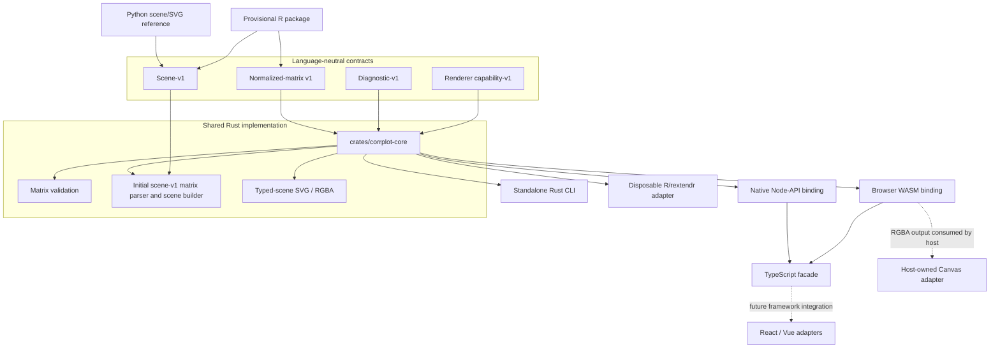

# Current architecture of corrplot-ng

## Purpose and status

This document distinguishes implemented slices from experimental integrations and planned work. Rust is the accepted strategic shared-core implementation. Production rollout of the Rust core into the R package remains gated by CRAN/package-footprint evidence and maintainer-workflow measurements.

The normalized-matrix v1 and **scene-v1** contracts are language-neutral input and interchange/conformance boundaries. Renderer capability declarations describe which scene semantics each output backend preserves; they do not alter the public figure configuration.

The Rust shared core lives in `crates/corrplot-core`. It currently provides matrix validation, an initial parser for the matrix-bearing subset of scene-v1, normalized-matrix-to-scene construction, and typed-scene SVG/RGBA rendering. The standalone CLI, Node-API binding, browser-WASM binding, and disposable R/rextendr adapter consume this crate for the operations implemented by each integration. These are shared implementation paths, not proof of complete semantic parity or a finished visualization engine.

The TypeScript facade in `packages/typescript/` selects the native Node or browser-WASM backend through runtime-specific exports. It exposes matrix validation, Rust-backed normalized-matrix scene construction, typed-scene SVG/RGBA rendering, matrix-bearing scene-v1 JSON compatibility rendering, renderer capabilities with optional renderer-ID verification, diagnostic errors, adapter injection, and disposal. It accepts JavaScript arrays with explicit `null` values or numeric typed arrays with an explicit boolean missing-cell mask. The initial API slice tracked by #145 is implemented.

Rust is the accepted strategic shared-core implementation. The remaining #173 production-R rollout gates are the controlled human maintainer-time comparison and CRAN guidance on the vendor-metadata NOTE and installed package size. No production R migration is authorized by the existing shared-operation proof. See [ADR 0001: Shared-core architecture](adr/0001-shared-core-architecture.md) and [ADR 0002: Cross-runtime TypeScript architecture](adr/0002-cross-runtime-typescript-architecture.md).

## Architecture at a glance

Solid edges represent implemented integration paths or contract use. Dashed edges represent host-side usage or unfinished integrations; they must not be read as a complete renderer or framework API. The browser binding returns SVG or owned RGBA data; it does not implement direct Canvas rendering. The R/rextendr adapter is a disposable evaluation integration, not the production R package.

## Contracts: stable boundaries, not a shared runtime

### Normalized-matrix v1

A language-neutral input contract for normalized matrix data. Language adapters can translate their native input into this representation. The contract is independent of the implementation language that performs validation, scene construction, or rendering.

### Scene-v1

A language-neutral representation of plot meaning and renderer-neutral scene content. It remains the interoperability and conformance boundary between producers and consumers. The Rust parser currently implements only the matrix-bearing subset needed by the first shared construction path; accepting scene-v1 JSON does not imply complete scene-v1 presentation semantics.

### Diagnostic-v1 and renderer capability-v1

The bindings expose structured diagnostic-v1 errors and the Rust core's capability-v1 declaration. These contracts keep failure and supported-feature reporting consistent across the current integrations. Capability declarations describe the implemented renderer subset, not complete scene-v1 support.

Contract versions and compatibility rules belong to the contract specifications. Runtime and packaging choices belong to the individual implementations.

## Implemented components

### Rust shared core and standalone CLI

The reusable library in `crates/corrplot-core` is the strategic shared implementation. Its current slice includes:

- Matrix validation with structured diagnostics.
- Parsing and validation of the matrix-bearing portion of scene-v1 JSON.
- Deterministic normalized-matrix-to-scene construction for the implemented options.
- Typed-scene SVG and RGBA rendering, including the documented renderer capability boundary.

The standalone CLI consumes this core and supports its documented publication-configuration and matrix-input export paths. The CLI remains a thin application adapter; it does not establish that all scene-v1 semantics or legacy plotting options are implemented.

### Native Node-API binding

The experimental binding in `bindings/node/` calls the same Rust core. Its implemented operations include matrix validation, typed-scene SVG/RGBA rendering, matrix-bearing scene-v1 to SVG/RGBA, and renderer capability reporting. RGBA pixels are returned in an owned Node Buffer with metadata.

The binding's focused PR CI runs on Linux x64 with Node 24. Comprehensive CI covers Linux x64 GNU, macOS x64, macOS arm64, and Windows x64 on Node 22, 24, and 26. This is an experimental, non-published integration; package preparation does not mean npm publication or production support.

### Browser WebAssembly binding

The binding in `bindings/wasm/` compiles the same Rust core for `wasm32-unknown-unknown`. It exposes matrix validation, typed-scene SVG/RGBA rendering, matrix-bearing scene-v1 to SVG/RGBA, and renderer capability reporting. RGBA pixels are copied into JavaScript-owned `Uint8Array` memory so they remain valid independently of later WASM calls.

Node-based WASM tests and package checks run on Node 24 and 26. The browser smoke suite exercises Chromium, Firefox, and WebKit on Ubuntu. The current build is single-threaded. This does not establish support for every browser version, mobile webview, threaded WASM, workers, or OffscreenCanvas.

### TypeScript facade

The facade in `packages/typescript/` provides runtime-specific exports and backend selection: Node.js loads the native Node-API backend, while browser builds load the WASM backend. It exposes matrix validation, Rust-backed normalized-matrix scene construction, typed-scene SVG/RGBA rendering, matrix-bearing scene-v1 JSON compatibility rendering, renderer capabilities with optional renderer-ID verification, diagnostic errors, adapter injection, and idempotent disposal. Matrix input accepts JavaScript arrays with explicit `null` values or numeric typed arrays with an explicit boolean missing-cell mask.

The initial API slice tracked by #145 is implemented. Full scene-v1 presentation semantics and broader cross-backend conformance remain separate work in #146; direct Canvas integration (#144) and React/Vue adapters (#291/#292) remain unfinished. See [the TypeScript package README](../packages/typescript/README.md).

### R package

The R implementation currently has distinct paths:

- **Legacy compatibility path:** delegates to the original corrplot behavior by default.
- **Normalized-matrix path:** adapts normalized matrix input.
- **Experimental scene path:** produces scene-v1 data; it is not a complete replacement renderer and does not imply full rendering parity.

The production R package has not migrated to the shared Rust core. The separate R/rextendr adapter is disposable evaluation evidence only. See [R implementation notes](../implementations/r/README.md).

### Python reference implementation

The Python shared-scene/SVG implementation serves as a reference and prototype for scene construction and SVG output. It is not the selected production shared core and does not establish parity with the Rust renderer.

## Experimental and planned work

The following capabilities remain incomplete or separately gated:

- **Production R integration:** gated by CRAN guidance on the vendor-metadata NOTE and installed package size, plus measured maintainer workflow effort (#173).
- **Full scene-v1 semantics and presentation fidelity:** the current parser and builder cover the matrix-bearing slice, not all scene-v1 fields and presentation behavior.
- **Full scene-v1 semantics and cross-backend conformance:** broader semantic and visual parity remain unfinished (#146). The initial normalized-matrix TypeScript scene workflow in #145 is implemented; direct Canvas remains separate (#144).
- **Direct browser Canvas:** the current WASM binding returns SVG or RGBA; Canvas drawing is host-owned. Direct Canvas/OffscreenCanvas integration remains #144.
- **React and Vue adapters:** not implemented.
- **Threaded WASM and worker orchestration:** the baseline is single-threaded; shared memory, worker lifecycle, and worker protocols are not provided by the package.
- **npm publication:** package build and tarball staging are non-publishing preparation. Public publication remains deferred under #293.
- **Cross-runtime semantic and visual parity:** current tests cover specific operations and fixtures; they do not prove complete API or presentation parity.

The Rust/rextendr integration remains a disposable evaluation adapter that proves shared-crate use for selected operations. C++/Rcpp remains an R-only fallback experiment, not a competing repository-wide shared-core direction. The controlled maintainer-time comparison and CRAN disposition remain open.

## Decision boundaries

| Area | Current position |
|---|---|
| Interoperability | Normalized-matrix v1 and scene-v1 contracts |
| Diagnostics and capabilities | Diagnostic-v1 and renderer capability-v1 are used by the current Rust-backed integrations |
| Strategic shared-core implementation | Rust (`crates/corrplot-core`); matrix validation, initial scene-v1 matrix construction, typed-scene SVG/RGBA are implemented |
| Standalone CLI | Implemented Rust consumer of the shared core |
| Native Node binding | Experimental Node-API integration; matrix validation, matrix-to-scene SVG/RGBA, typed-scene SVG/RGBA implemented |
| Browser WASM | Experimental binding over the same Rust core; matrix-to-scene SVG/RGBA and typed-scene SVG/RGBA implemented |
| TypeScript facade | Runtime-isolated Node/browser API, normalized-matrix scene construction, typed-scene SVG/RGBA, typed-array input, scene-v1 compatibility rendering, capabilities and diagnostics implemented; full scene-v1 parity remains incomplete |
| R compatibility | Legacy path plus normalized-input and experimental scene paths; production Rust integration not approved |
| Rust/rextendr and C++/Rcpp | Evaluation spikes; rextendr consumes the shared Rust core for implemented operations |
| Python shared-scene/SVG | Reference/prototype implementation |
| Direct Canvas, workers, React/Vue | Not implemented |
| npm publication | Explicitly deferred |

The accepted Rust shared-core direction now has working CLI, Node, and browser-WASM consumers for the implemented operation slice. That does not imply complete semantic parity, full scene-v1 presentation support, or production status for the bindings. Keep language-specific adapters thin, preserve scene-v1 as the versioned interchange/conformance contract, and keep production R rollout and npm publication behind their separate gates.

## Dependency principles

1. Language-specific APIs and adapters own conversion from native inputs to the versioned language-neutral contracts.
2. Contract definitions remain independent of a particular implementation language or runtime.
3. Producers and consumers communicate through explicit, versioned contract data.
4. Rendering adapters consume scene data and own output-specific behavior.
5. Experimental bindings and future adapters remain clearly separated from production-supported interfaces.
6. Common correlation and visualization semantics belong in the Rust core as they are implemented; do not duplicate them in adapters.
7. Keep R-specific legacy compatibility and graphics-device behavior in the R adapter.
8. Keep browser DOM, Canvas, workers, and framework lifecycle concerns outside the portable Rust core.

These principles keep contract interoperability explicit while assigning shared semantic operations to Rust and runtime-specific behavior to thin adapters.
