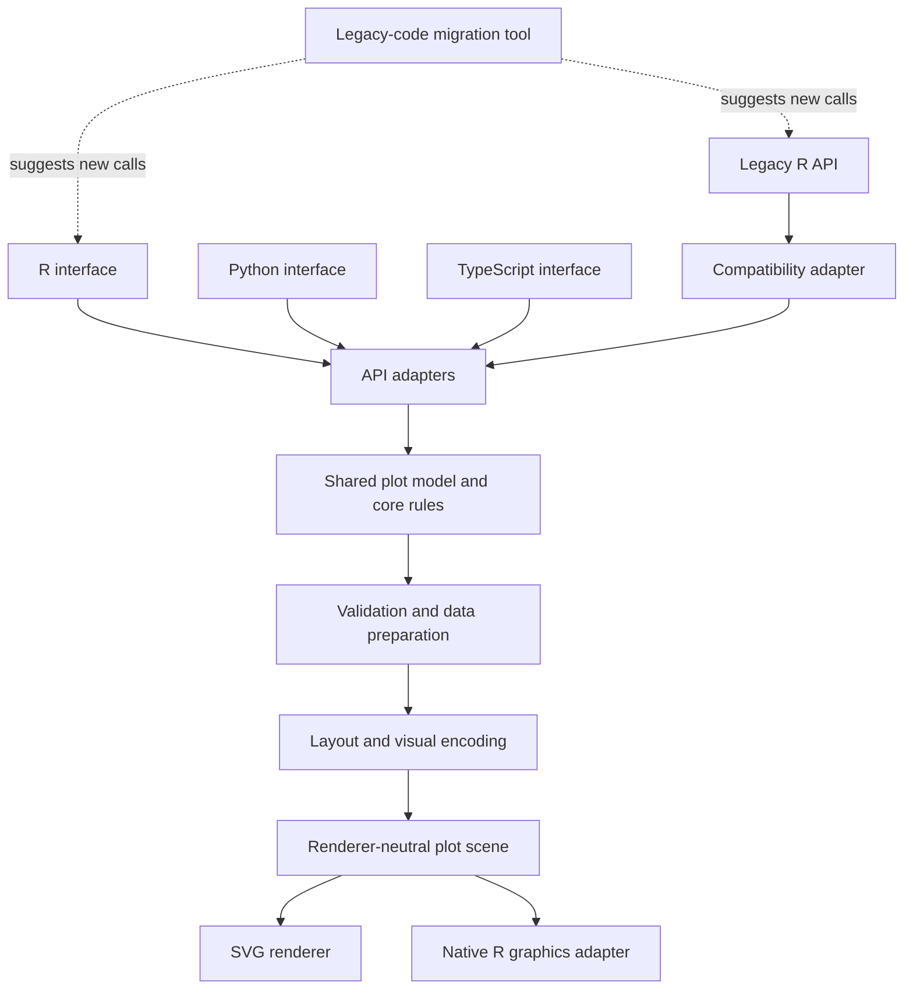

# Proposed architecture for corrplot-ng

## Purpose

This document describes a proposed architecture. It is not a record of implemented software or a final technology decision. Use a small prototype to test the design before committing to it.

## Architecture overview

The main design rule is to keep plot meaning and shared visual rules in one language-neutral model. Language interfaces should translate their public APIs into that model. Rendering backends should turn the model into output for each target environment.

The diagram shows logical parts, not a required process or package layout. The final design may combine or split these parts.

## Main components

### 1. Language interfaces

Provide a public API that fits each language.

- The R interface supports current R users and the legacy compatibility layer.
- The Python interface follows common Python usage patterns.
- The TypeScript interface supports JavaScript and web applications.
- Each interface validates language-specific input and converts it to the shared model.

Interfaces must not define different meanings for the same shared option unless a documented platform limit requires it.

### 2. Legacy R compatibility adapter

Map legacy function calls and arguments to the shared model where practical.

- Keep the original R package as the behavior reference.
- Record legacy behavior with tests before replacing code.
- Preserve argument defaults, ordering, labels, annotations, return behavior, and graphics behavior where required.
- Report known gaps. Do not claim full compatibility without test evidence.

Some legacy behavior may need to remain in the R adapter. In particular, existing R code can draw extra elements on the active graphics device with functions such as `text()`, `segments()`, and `points()`. Returning an SVG string alone does not preserve that workflow. The prototype must test how the R interface can draw the shared plot and still allow subsequent native R drawing.

### 3. Shared plot model and core rules

Define the meaning of a plot independently of a particular programming language or renderer.

The core should own, where practical:

- Input data representation and validation rules.
- Correlation values and missing-value handling.
- Mapping values to colors, sizes, shapes, and symbols.
- Matrix layout and variable ordering.
- Labels, annotations, legends, and scales.
- A renderer-neutral description of plot elements and their geometry.

The core should not depend on an interactive user interface or on one output format.

### 4. Rendering interface and backends

The rendering interface receives the prepared plot model and sends it to a target backend.

**Current proposal to test:**

- Use a renderer-neutral plot scene as the boundary between shared plot rules and output formats.
- Test SVG as the primary vector output. It is text-based, portable, and suitable for deterministic structural tests.
- Keep native R graphics integration as a separate compatibility concern, rather than assuming that SVG output behaves like an active R graphics device.
- Consider other backends only when a concrete use case justifies them.

SVG output may be identical when the same scene and serializer are used. Rasterized PNG images may still differ because of fonts, rendering engines, and antialiasing. Tests should compare the scene or normalized SVG exactly where possible, and use image tolerances when comparing raster output.

### 5. User-defined plot elements

The design should support adding user-defined elements without putting language-specific drawing rules into the shared core.

For the new API, consider representing annotations as elements in the shared plot scene before rendering. The scene needs a documented coordinate system and a clear rule for layering elements.

For the legacy R API, test a separate integration path that preserves common drawing operations on the active graphics device. Do not assume that every R graphics operation can be translated automatically to SVG or to another language.

The prototype should answer these questions:

- Can the same shared plot scene produce stable SVG output?
- Can the R adapter draw the plot and still support common follow-up calls such as `text()` and `segments()`?
- Which legacy drawing behaviors cannot be preserved by the shared scene alone?

### 6. Legacy-code migration tool

Help users move from legacy R calls to the new API.

- Start with a small set of common patterns.
- Show suggested replacements and warnings.
- Do not silently change code.
- Identify cases that need manual review.

A migration tool is a helper. It does not replace compatibility support.

## Suggested dependency direction

Use this dependency direction:

1. Language-specific calls enter through an interface or adapter.
2. The interface creates the shared plot model.
3. The core validates data and resolves shared visual rules.
4. The core produces a renderer-neutral plot scene.
5. A backend renders the scene for the target environment.

The shared core must not call back into language interfaces. This keeps the core easier to test and reuse.

## Technology choice

Rust is a candidate for the shared core, but it is not a final decision.

A small prototype should compare:

- Calling the core from R and at least one other language.
- Build and installation complexity.
- Support for required data types.
- Stable SVG output and native R graphics integration.
- Testing, debugging, packaging, and long-term maintenance.

Choose the smallest design that meets the top-level requirements. Avoid extra services or runtime layers unless a tested need justifies them.

## Open questions

- Is a renderer-neutral plot scene the right boundary between core rules and rendering?
- Does SVG meet the initial output needs, and what is the simplest way to support native R graphics?
- Which legacy behaviors must be reproduced exactly?
- Which user-defined drawing operations can be represented in the shared scene, and which need a native R path?
- What is the simplest packaging model for each language?
- Does Rust provide enough benefit to justify its build and distribution cost?

## Prototype acceptance criteria

The first prototype should:

- Render one representative correlation plot from a language-neutral input.
- Produce stable SVG from the same input and configuration.
- Keep layout and visual rules outside language-specific adapters.
- Demonstrate at least one user-defined annotation.
- Test whether the R adapter can preserve a common post-plot drawing operation.
- Document build complexity and any behavior that cannot be preserved.
