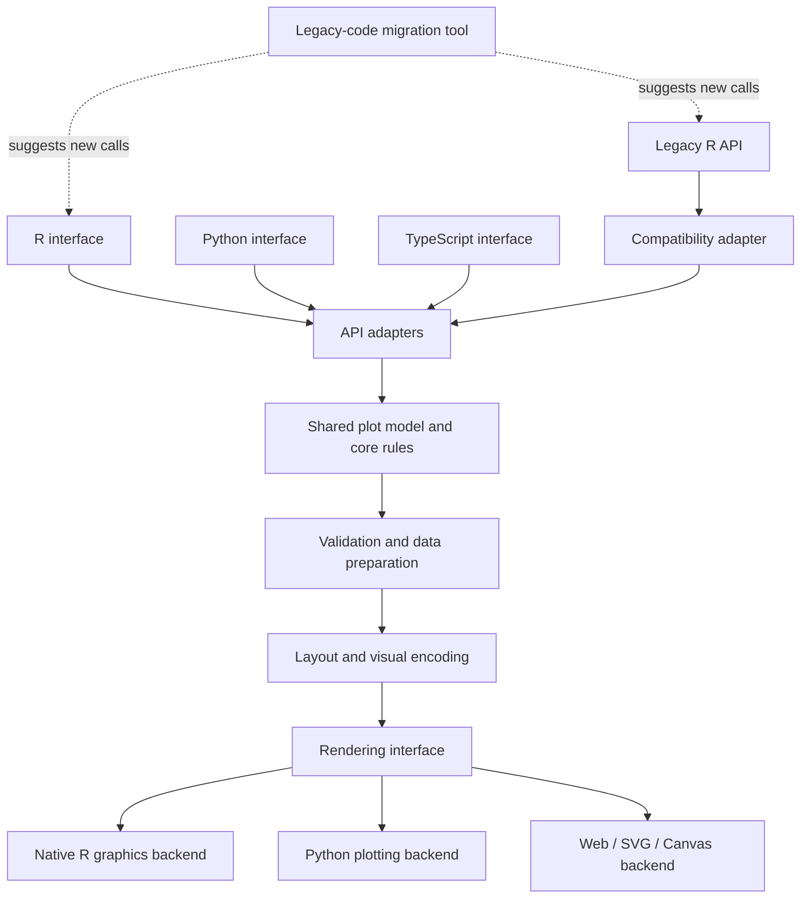

# Proposed architecture for corrplot-ng

## Purpose

This document describes a possible architecture. It is a proposal, not a record of implemented software. The design must be tested with a small prototype before the project commits to a technology.

## Architecture overview

The main design rule is to keep plot meaning and shared behavior in one language-neutral model. Language interfaces should translate their public APIs into that model. Rendering backends should turn the model into output for each target environment.

The diagram shows logical parts, not a required process or package layout. The final design may combine or split these parts.

## Main components

### 1. Language interfaces

Provide a public API that fits each language.

- The R interface supports current R users and the legacy compatibility layer.
- The Python interface follows common Python usage patterns.
- The TypeScript interface supports JavaScript and web applications.
- Each interface validates language-specific input and converts it to the shared model.

Interfaces must not define different meanings for the same shared option unless a documented platform limit requires it.

### 2. Legacy R compatibility adapter

Map legacy function calls and arguments to the shared model.

- Keep the original R package as the behavior reference.
- Record legacy behavior with tests before replacing code.
- Preserve argument defaults, ordering, labels, annotations, and return behavior where required.
- Report known gaps. Do not claim full compatibility without test evidence.

The compatibility adapter may need to keep some legacy behavior outside the shared core when exact compatibility requires it.

### 3. Shared plot model and core rules

Define the meaning of a plot independently of a particular programming language or renderer.

The core should own, where practical:

- Input data representation and validation rules.
- Correlation values and missing-value handling.
- Mapping values to colors, sizes, shapes, and symbols.
- Matrix layout and variable ordering.
- Labels, annotations, legends, and scales.
- A renderer-neutral description of plot elements.

The core should not depend on an interactive user interface or on one output format.

### 4. Rendering interface and backends

The rendering interface receives the prepared plot model and sends it to a target backend.

Possible backends include:

- R graphics output.
- Python plotting output.
- SVG, Canvas, or another web output.

A backend may have platform-specific limits. These limits must be documented and tested. The project should avoid duplicating plot rules in each backend.

### 5. Legacy-code migration tool

Help users move from legacy R calls to the new API.

- Start with a small set of common patterns.
- Show suggested replacements and warnings.
- Do not silently change code.
- Identify cases that need manual review.

A migration tool is a helper. It does not replace compatibility support.

## Suggested dependency direction

Use this dependency direction:

1. Language-specific calls enter through an interface or adapter.
2. The interface creates the shared plot model.
3. The core validates data and resolves shared visual rules.
4. A renderer converts the result to platform output.

The shared core must not call back into language interfaces. This keeps the core easier to test and reuse.

## Technology choice

Rust is a candidate for the shared core, but it is not a final decision.

A prototype should compare:

- Calling the core from R, Python, and TypeScript.
- Build and installation complexity.
- Support for required data types.
- Rendering quality and native integration.
- Testing, debugging, packaging, and long-term maintenance.

Choose the smallest design that meets the top-level requirements. Avoid extra services or runtime layers unless a tested need justifies them.

## Open questions

- Should the core return a renderer-neutral scene, or should it render through backend adapters?
- Which rendering backends are needed for the first useful release?
- Which legacy behaviors must be reproduced exactly?
- Which parts can be shared without making native language integration difficult?
- What is the simplest packaging model for each language?
