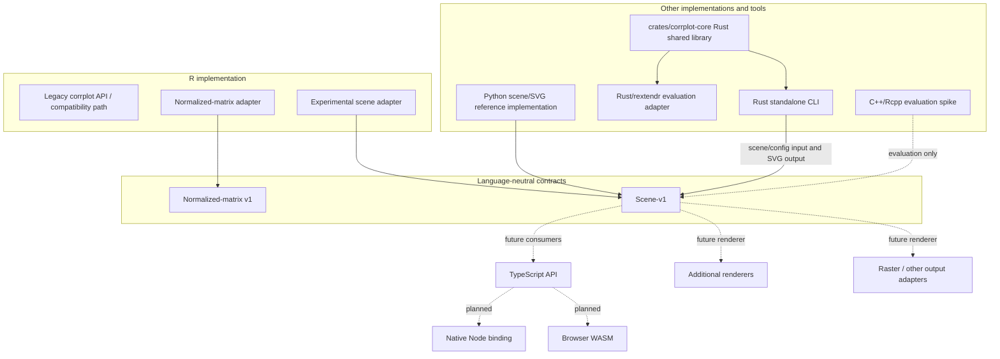

# Current architecture of corrplot-ng

## Purpose and status

This document distinguishes the implemented architecture from experiments and planned work. Rust is the accepted strategic shared-core implementation. The production rollout of the Rust core into the R package remains gated by packaging guidance and maintainer-workflow evidence.

The normalized-matrix v1 and **scene-v1** contracts are language-neutral input and interchange/conformance boundaries. Renderer capability declarations describe which scene semantics each output backend preserves; they do not alter the public figure configuration. The Rust shared core lives in `crates/corrplot-core`. The standalone CLI and disposable R/rextendr adapter both depend on that exact crate and call its matrix-validation API, as demonstrated by merged PR #180. This is the first shared operation, not yet the complete correlation/visualization engine.

Rust is the accepted strategic shared-core implementation. The remaining #173 rollout gates are the controlled human maintainer-time comparison and CRAN guidance on the vendor-metadata NOTE and installed package size. No production R migration is authorized by this proof. See [ADR 0001: Shared-core architecture](adr/0001-shared-core-architecture.md).

## Architecture at a glance

Solid edges represent current implementation paths or contract use. Dashed edges represent experiments, future consumers, or planned work; they must not be read as shipped production capabilities. The shared Rust crate currently provides matrix validation; it does not yet implement all scene construction or rendering semantics.

## Contracts: stable boundaries, not a shared runtime

### Normalized-matrix v1

A language-neutral input contract for normalized matrix data. Language adapters can translate their native input into this representation. The contract is independent of the implementation language that performs validation, layout, or rendering.

### Scene-v1

A language-neutral representation of plot meaning and renderer-neutral scene content. It is the interoperability boundary between producers and consumers. A producer and a renderer may be implemented in different languages and communicate through this contract; they do not need to link to one common native library.

Contract versions and compatibility rules belong to the contract specifications. Runtime and packaging choices belong to the individual implementations.

## Implemented components

### R package

The R implementation currently has distinct paths:

- **Legacy compatibility path:** delegates to the original corrplot behavior by default.
- **Normalized-matrix path:** adapts normalized matrix input.
- **Experimental scene path:** produces scene-v1 data; it is not yet a complete replacement renderer and does not imply full rendering parity.

The R package therefore remains a compatibility-focused implementation with incremental new contract support, not a finished front end to a production shared native core. See [R implementation notes](../implementations/r/README.md).

### Rust standalone CLI

The standalone command-line tool is implemented in Rust and consumes `crates/corrplot-core` for matrix validation. The reusable Rust library is the selected strategic shared core. Its current API is deliberately small; the proof does not mean that the full visualization engine or production R binding has shipped.

### Python reference implementation

The Python shared-scene/SVG implementation serves as a reference and prototype for working with the scene representation and SVG output. It is not the selected production shared core.

## Experimental integrations

The Rust/rextendr integration remains a disposable evaluation adapter that proves the CLI and R can call the same compiled crate. It is not part of the production R package. C++/Rcpp remains an R-only fallback experiment, not a competing shared-core direction. The controlled maintainer-time comparison and CRAN disposition remain open.

## Planned work

The following capabilities are tracked as future work, not as current shipped architecture:

- TypeScript API and shared cross-runtime architecture (#139).
- Portable reusable Rust core for native and WebAssembly targets (#140).
- Native Node.js binding (#141).
- Browser WebAssembly integration (#142).
- Renderer-neutral output interface and additional output formats (#143, #153, #154).
- Direct browser Canvas rendering (#144).
- Unified TypeScript API with backend selection (#145).
- Cross-backend parity, visual regression, and performance coverage (#146).

The standalone CLI should remain distinct from a future reusable native library. Likewise, browser Canvas rendering is a separate adapter from server-side or CLI rendering.

## Decision boundaries

| Area | Current position |
|---|---|
| Interoperability | Normalized-matrix v1 and scene-v1 contracts |
| Scene boundary | Accepted; scene-v1 is language-neutral |
| Standalone CLI | Implemented in Rust |
| Strategic shared-core implementation | Rust (`crates/corrplot-core`); full semantics still in progress |
| Rust/rextendr and C++/Rcpp | Experimental evaluation spikes |
| Python shared-scene/SVG | Reference/prototype implementation |
| R compatibility | Legacy path plus normalized-input and experimental scene paths |
| TypeScript, Node binding, browser WASM and Canvas | Planned |

The Rust shared-core direction is accepted and the initial crate-reuse proof is complete. Production R rollout still requires CRAN guidance and measured maintainer effort. Keep language-specific adapters thin and keep scene-v1 as the versioned interchange/conformance contract.

## Dependency principles

1. Language-specific APIs and adapters own conversion from native inputs to the versioned language-neutral contracts.
2. Contract definitions remain independent of a particular implementation language or runtime.
3. Producers and consumers communicate through explicit, versioned contract data.
4. Rendering adapters consume scene data and own output-specific behavior.
5. Experimental bindings and future adapters remain clearly separated from supported implementation paths.
6. Common correlation and visualization semantics belong in the Rust core as they are implemented; do not duplicate them in adapters.
7. Keep R-specific legacy compatibility and graphics-device behavior in the R adapter.

These principles keep contract interoperability explicit while assigning shared implementation semantics to the Rust core and runtime-specific behavior to thin adapters.
