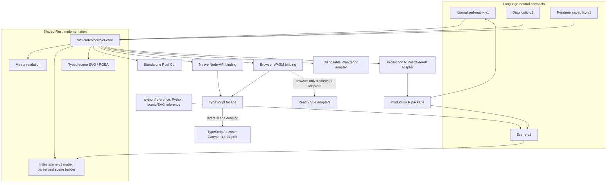

# Current architecture of corrplot-ng

## Purpose and status

This document distinguishes implemented slices from experimental integrations and planned work. Rust is the accepted strategic shared-core implementation. The production R package now embeds the shared Rust core and exposes an opt-in Rust-backed SVG renderer for a documented scene-v1 subset (PR #417). The legacy corrplot path remains the default; this is a bounded experimental integration, not a wholesale replacement renderer or a CRAN release. The proposed maintainer-effort comparison was discontinued by #269 and is not a gate.

The normalized-matrix v1 and **scene-v1** contracts are language-neutral input and interchange/conformance boundaries. Renderer capability declarations describe which scene semantics each output backend preserves; they do not alter the public figure configuration.

For clean setup and project-specific build, test, and artifact commands, see the [developer setup guide](development.md).

The Rust shared core lives in `rust/crates/corrplot-core`. It currently provides matrix validation, an initial parser for the matrix-bearing subset of scene-v1, normalized-matrix-to-scene construction, and typed-scene SVG/RGBA rendering. The standalone CLI, Node-API binding, browser-WASM binding, and disposable R/rextendr adapter consume this crate for the operations implemented by each integration. These are shared implementation paths, not proof of complete semantic parity or a finished visualization engine.

The TypeScript facade in `npm/packages/typescript/` selects the native Node or browser-WASM backend through runtime-specific exports. It exposes matrix validation, Rust-backed normalized-matrix scene construction, typed-scene SVG/RGBA rendering, matrix-bearing scene-v1 JSON compatibility rendering, renderer capabilities with optional renderer-ID verification, diagnostic errors, adapter injection, and disposal. It accepts JavaScript arrays with explicit `null` values or numeric typed arrays with an explicit boolean missing-cell mask. The initial API slice tracked by #145 is implemented.

Rust is the accepted strategic shared-core implementation. PR #417 integrated the shared core into the production R package behind an opt-in SVG renderer. The production package candidate passed offline source installation, renderer smoke tests, and `R CMD check --as-cran --no-manual` with `Status: OK` and no NOTE on Linux, macOS, and Windows; the Windows binary ZIP also installed and passed its smoke test without Cargo/rustc on PATH. The recorded Ubuntu source tarball was 2,610,492 bytes and the installed package was 2,631,354 bytes. This is engineering and packaging evidence, not CRAN acceptance. Issue #268 tracks the separate historical prototype NOTE disposition; the current production archive retains Cargo integrity metadata inside the compressed vendor archive and does not reproduce that NOTE. See [ADR 0001: Shared-core architecture](adr/0001-shared-core-architecture.md), [ADR 0002: Cross-runtime TypeScript architecture](adr/0002-cross-runtime-typescript-architecture.md), and [issue #173](https://github.com/vsimko/corrplot-ng/issues/173).

## Architecture at a glance

Solid edges represent implemented integration paths or contract use. Dashed edges represent host-owned boundaries. React and Vue are thin browser adapters over WASM; they do not implement correlation semantics. The browser binding provides shared SVG/RGBA operations; direct Canvas drawing is implemented separately by the TypeScript/browser adapter. The production R package has its own embedded Rust/extendr adapter and opt-in SVG renderer; the separate prototype R/rextendr adapter remains a disposable evaluation integration.

## Contracts: stable boundaries, not a shared runtime

### Normalized-matrix v1

A language-neutral input contract for normalized matrix data. Language adapters can translate their native input into this representation. The contract is independent of the implementation language that performs validation, scene construction, or rendering.

### Scene-v1

A language-neutral representation of plot meaning and renderer-neutral scene content. It remains the interoperability and conformance boundary between producers and consumers. The Rust parser currently implements only the matrix-bearing subset needed by the first shared construction path; accepting scene-v1 JSON does not imply complete scene-v1 presentation semantics.

### Diagnostic-v1 and renderer capability-v1

The bindings expose structured diagnostic-v1 errors and the Rust core's capability-v1 declaration. These contracts keep failure and supported-feature reporting consistent across the current integrations. Capability declarations describe the implemented renderer subset, not complete scene-v1 support.

Contract versions and compatibility rules belong to the contract specifications. Runtime and packaging choices belong to the individual implementations.

## Implemented components

### Rust shared core and standalone CLI

The reusable library in `rust/crates/corrplot-core` is the strategic shared implementation. Its current slice includes:

- Matrix validation with structured diagnostics.
- Parsing and validation of the matrix-bearing portion of scene-v1 JSON.
- Deterministic normalized-matrix-to-scene construction for the implemented options.
- Typed-scene SVG and RGBA rendering, including the documented renderer capability boundary.

The standalone CLI consumes this core and supports its documented publication-configuration and matrix-input export paths. The CLI remains a thin application adapter; it does not establish that all scene-v1 semantics or legacy plotting options are implemented.

### Native Node-API binding

The Rust crate in `rust/bindings/node/`, packaged through `npm/packages/native-node/` calls the same Rust core. Its implemented operations include matrix validation, typed-scene SVG/RGBA rendering, matrix-bearing scene-v1 to SVG/RGBA, and renderer capability reporting. RGBA pixels are returned in an owned Node Buffer with metadata.

The binding's focused PR CI runs on Linux x64 with Node 24. Comprehensive CI covers Linux x64 GNU, macOS x64, macOS arm64, and Windows x64 on Node 22, 24, and 26. This is an experimental, non-published integration; package preparation does not mean npm publication or production support.

### Browser WebAssembly binding

The Rust crate in `rust/bindings/wasm/`, packaged through `npm/packages/wasm/` compiles the same Rust core for `wasm32-unknown-unknown`. It exposes matrix validation, typed-scene SVG/RGBA rendering, matrix-bearing scene-v1 to SVG/RGBA, and renderer capability reporting. RGBA pixels are copied into JavaScript-owned `Uint8Array` memory so they remain valid independently of later WASM calls.

Node-based WASM tests and package checks run on Node 24 and 26. The browser smoke suite exercises Chromium, Firefox, and WebKit on Ubuntu. The current WASM build is single-threaded. This does not establish support for every browser version or mobile webview. OffscreenCanvas is a separate TypeScript/browser host target and is used only when the runtime exposes a working 2D context. The package does not provide threaded WASM, worker transport, worker lifecycle, or worker protocols.

### TypeScript facade

The facade in `npm/packages/typescript/` provides runtime-specific exports and backend selection: Node.js loads the native Node-API backend, while browser builds load the WASM backend. It exposes matrix validation, Rust-backed normalized-matrix scene construction, typed-scene SVG/RGBA rendering, matrix-bearing scene-v1 JSON compatibility rendering, renderer capabilities with optional renderer-ID verification, diagnostic errors, adapter injection, and idempotent disposal. Matrix input accepts JavaScript arrays with explicit `null` values or numeric typed arrays with an explicit boolean missing-cell mask.

The initial API slice tracked by #145 is implemented. Direct Canvas 2D rendering (#144) is implemented by the browser-only TypeScript adapter; it is not a Rust/WASM output operation. The initial cross-backend parity, visual-conformance, capability, and informational performance-baseline suite was completed under #146; this does not imply complete scene-v1 presentation semantics. The React adapter (#291) is implemented in `npm/packages/react/`, and the Vue adapter (#292) is implemented in `npm/packages/vue/`; both are browser-only components over the WASM backend. See the [TypeScript package README](../npm/packages/typescript/README.md), [React package README](../npm/packages/react/README.md), and [Vue package README](../npm/packages/vue/README.md).

### R package

The R implementation currently has distinct paths:

- **Legacy compatibility path:** delegates to the original corrplot behavior by default.
- **Normalized-matrix path:** adapts normalized matrix input.
- **Experimental scene path:** produces scene-v1 data; it is not a complete replacement renderer and does not imply full rendering parity.
- **Opt-in Rust SVG path:** uses the shared Rust core through the package's embedded extendr adapter to render the documented supported scene-v1 subset. It is experimental and does not replace the default legacy plotting path or establish full scene-v1 parity.

The production R package now embeds the shared Rust core for this bounded renderer integration. The separate `rust/bindings/r/rextendr-prototype` package remains a disposable evaluation adapter. See [R implementation notes](../r/corrplotng/README.md).

### Python reference implementation

The Python reference in `python/reference/` serves as a prototype for scene construction and SVG output. It is not the selected production shared core and does not establish parity with the Rust renderer.

## Experimental and planned work

The following capabilities remain incomplete or separately gated:

- **Broader production R renderer scope:** the current opt-in Rust SVG renderer is limited to its documented scene-v1 subset; expanding semantics and presentation fidelity requires separate conformance evidence. The production package candidate has passed the current three-platform packaging and CRAN-mode checks, but this is not CRAN acceptance.
- **Full scene-v1 semantics and presentation fidelity:** the current parser and builder cover the matrix-bearing slice, not all scene-v1 fields and presentation behavior.
- **Cross-backend conformance:** the initial shared-fixture parity, browser visual-regression, renderer-capability, and informational performance-baseline suite was completed under #146. The parser and builder still cover only the matrix-bearing scene-v1 subset; full presentation semantics remain incomplete.
- **Direct browser Canvas:** implemented by the TypeScript/browser adapter (#144), which draws the shared scene directly with Canvas 2D. The WASM binding still exposes SVG/RGBA operations and does not implement Canvas drawing. OffscreenCanvas is feature-detected and available only when the runtime supplies a working 2D context.
- **React adapter:** implemented in `npm/packages/react/` as a browser-only component and hook over the WASM package; React is a peer dependency.
- **Vue adapter:** implemented in `npm/packages/vue/` as a browser-only component and composable over the WASM package; Vue is a peer dependency.
- **Threaded WASM and worker orchestration:** the baseline is single-threaded; shared memory, worker lifecycle, and worker protocols are not provided by the package.
- **npm publication:** package build and tarball staging are non-publishing preparation. Public publication remains deferred under #293.
- **Cross-runtime semantic and visual parity:** current tests cover specific operations and fixtures; they do not prove complete API or presentation parity.

The disposable Rust/rextendr prototype remains separate from the production R package. The production package now embeds the shared core for its opt-in SVG renderer. Rust is the sole selected native implementation; C++/Rcpp has been rejected and its prototype and CI have been retired. The historical prototype NOTE disposition and sustainable Rust maintenance remain open.

## Decision boundaries

| Area | Current position |
|---|---|
| Interoperability | Normalized-matrix v1 and scene-v1 contracts |
| Diagnostics and capabilities | Diagnostic-v1 and renderer capability-v1 are used by the current Rust-backed integrations |
| Strategic shared-core implementation | Rust (`rust/crates/corrplot-core`); matrix validation, initial scene-v1 matrix construction, typed-scene SVG/RGBA are implemented |
| Standalone CLI | Implemented Rust consumer of the shared core |
| Native Node binding | Experimental Node-API integration; matrix validation, matrix-to-scene SVG/RGBA, typed-scene SVG/RGBA implemented |
| Browser WASM | Experimental binding over the same Rust core; matrix-to-scene SVG/RGBA and typed-scene SVG/RGBA implemented |
| TypeScript facade | Runtime-isolated Node/browser API, normalized-matrix scene construction, typed-scene SVG/RGBA, typed-array input, scene-v1 compatibility rendering, capabilities and diagnostics implemented; full scene-v1 parity remains incomplete |
| R compatibility | Legacy default path plus normalized-input/scene preparation and an opt-in experimental Rust-backed SVG renderer in the production package |
| Rust/rextendr | Disposable evaluation adapter; consumes the shared Rust core for implemented operations |
| C++/Rcpp | Rejected; prototype and CI retired; not an approved fallback |
| Python shared-scene/SVG | Reference/prototype implementation |
| Direct Canvas 2D | Implemented by the TypeScript/browser adapter; OffscreenCanvas is conditional on runtime support |
| Workers and threaded WASM | Worker transport, lifecycle/protocols, shared-memory threading are not provided |
| npm publication | Explicitly deferred |

The accepted Rust shared-core direction now has working CLI, Node, browser-WASM, and production R consumers for the implemented operation slice. The Node/WASM packages remain experimental and unpublished; the production R SVG renderer is opt-in and experimental while the legacy plotting path remains the default. This does not imply complete semantic parity, full scene-v1 presentation support, or CRAN acceptance. Keep language-specific adapters thin, preserve scene-v1 as the versioned interchange/conformance contract, and keep broader R renderer expansion and npm publication behind their separate gates.

## Dependency principles

1. Language-specific APIs and adapters own conversion from native inputs to the versioned language-neutral contracts.
2. Contract definitions remain independent of a particular implementation language or runtime.
3. Producers and consumers communicate through explicit, versioned contract data.
4. Rendering adapters consume scene data and own output-specific behavior.
5. Experimental bindings and future adapters remain clearly separated from production-supported interfaces.
6. Common correlation and visualization semantics belong in the Rust core as they are implemented; do not duplicate them in adapters.
7. Keep R-specific legacy compatibility and graphics-device behavior in the R adapter.
8. Keep browser DOM, Canvas, workers, and framework lifecycle concerns outside the portable Rust core.

These principles keep contract interoperability explicit while assigning shared semantic operations to Rust and runtime-specific behavior to thin adapters.
