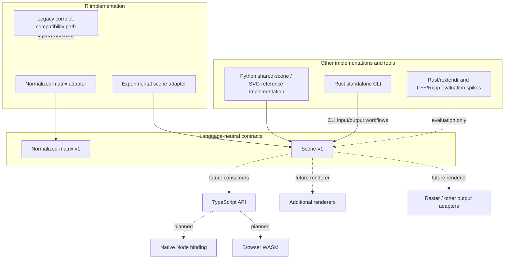

# Current architecture of corrplot-ng

## Purpose and status

This document describes the architecture that exists in the repository today and distinguishes it from experiments and planned work. It is not a commitment to a single compiled implementation shared by every language.

The stable interoperability boundary is the language-neutral **scene-v1** contract. The normalized-matrix v1 contract provides a language-neutral representation of normalized matrix input. These contracts allow implementations to exchange data without requiring them to use the same programming language, runtime, or binary.

The production shared-core language decision is deliberately **deferred**. See [ADR 0001: Shared-core architecture](adr/0001-shared-core-architecture.md) for the rationale and decision record.

## Architecture at a glance

Solid edges represent current implementation paths or contract use. Dashed edges represent experiments, future consumers, or planned work; they must not be read as shipped production capabilities.

## Contracts: stable boundaries, not a shared runtime

### Normalized-matrix v1

A language-neutral input contract for normalized matrix data. Language adapters can translate their native input into this representation. The contract is independent of the implementation language that performs validation, layout, or rendering.

### Scene-v1

A language-neutral representation of plot meaning and renderer-neutral scene content. It is the interoperability boundary between producers and consumers. A producer and a renderer may be implemented in different languages and communicate through this contract; they do not need to link to one common native library.

Contract versions and compatibility rules belong to the contract specifications. Runtime and packaging choices belong to the individual implementations.

## Implemented components

### R package

The R implementation currently has distinct paths:

- **Legacy compatibility path:** delegates to the original corrplot behavior by default.
- **Normalized-matrix path:** adapts normalized matrix input.
- **Experimental scene path:** produces scene-v1 data; it is not yet a complete replacement renderer and does not imply full rendering parity.

The R package therefore remains a compatibility-focused implementation with incremental new contract support, not a finished front end to a production shared native core. See [R implementation notes](../implementations/r/README.md).

### Rust standalone CLI

The standalone command-line tool is implemented in Rust. This is a decision about the CLI implementation and its distribution/toolchain. It does **not** establish Rust as the production shared-core language, nor does it mean that a reusable native library for R, Node.js, and other consumers already exists.

### Python reference implementation

The Python shared-scene/SVG implementation serves as a reference and prototype for working with the scene representation and SVG output. It is not the selected production shared core.

## Experimental integrations

Rust/rextendr and C++/Rcpp integrations have been used as evaluation spikes. They are not production R backends and should not be presented as supported deployment paths.

Experiments can inform future decisions, but an experiment does not change the architecture decision unless that decision is explicitly revisited and recorded.

## Planned work

The following capabilities are tracked as future work, not as current shipped architecture:

- TypeScript API and shared cross-runtime architecture (#139).
- Portable reusable Rust core for native and WebAssembly targets (#140).
- Native Node.js binding (#141).
- Browser WebAssembly integration (#142).
- Renderer-neutral output interface and additional output formats (#143, #153, #154).
- Direct browser Canvas rendering (#144).
- Unified TypeScript API with backend selection (#145).
- Cross-backend parity, visual regression, and performance coverage (#146).

The standalone CLI should remain distinct from a future reusable native library. Likewise, browser Canvas rendering is a separate adapter from server-side or CLI rendering.

## Decision boundaries

| Area | Current position |
|---|---|
| Interoperability | Normalized-matrix v1 and scene-v1 contracts |
| Scene boundary | Accepted; scene-v1 is language-neutral |
| Standalone CLI | Implemented in Rust |
| Production shared-core language | Deferred by ADR 0001 |
| Rust/rextendr and C++/Rcpp | Experimental evaluation spikes |
| Python shared-scene/SVG | Reference/prototype implementation |
| R compatibility | Legacy path plus normalized-input and experimental scene paths |
| TypeScript, Node binding, browser WASM and Canvas | Planned |

A future shared native core should be considered only when a concrete multi-consumer requirement demonstrates that the benefits outweigh the build, packaging, ABI, and maintenance costs. Any change to the deferred language decision requires a separate evidence-backed ADR update; it must not be introduced implicitly through implementation or documentation.

## Dependency principles

1. Language-specific APIs and adapters own conversion from native inputs to the versioned language-neutral contracts.
2. Contract definitions remain independent of a particular implementation language or runtime.
3. Producers and consumers communicate through explicit, versioned contract data.
4. Rendering adapters consume scene data and own output-specific behavior.
5. Experimental bindings and future adapters remain clearly separated from supported implementation paths.

This keeps interoperability independent from the unresolved question of whether any particular functionality should eventually be factored into a shared compiled library.
