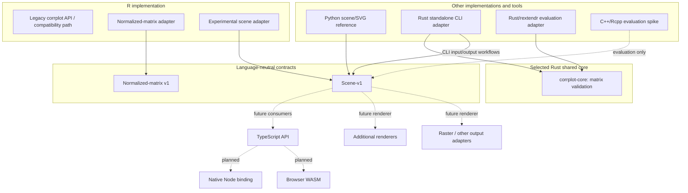

# Current architecture of corrplot-ng

## Purpose and status

This document describes the architecture that exists in the repository today and distinguishes it from experiments and planned work. Rust is the selected implementation for shared semantics; the current compiled-library proof is deliberately narrow and does not claim a complete production visualization engine.

The stable interoperability boundary is the language-neutral **scene-v1** contract. The normalized-matrix v1 contract provides a language-neutral representation of normalized matrix input. Renderer capability declarations describe which scene semantics each output backend preserves; they do not alter the public figure configuration. Separately, `crates/corrplot-core` provides the first shared compiled operation: matrix validation called by both the standalone CLI and the disposable R/rextendr adapter. Scene-v1 remains the language-neutral interchange contract; it complements rather than replaces compiled-library reuse.

Rust is the selected shared-core implementation under [ADR 0001: Shared-core architecture](adr/0001-shared-core-architecture.md). The current crate proof covers matrix validation only. Expanding it to production scene construction/rendering and migrating the R package remain gated by portability, package, CRAN, and maintenance evidence.

## Architecture at a glance

Solid edges represent current implementation paths or contract use. The R/rextendr adapter is an isolated package experiment that calls the shared Rust validation crate; it is not a production R backend. Dashed edges represent future consumers or planned work.

## Contracts and shared library: complementary boundaries

### Normalized-matrix v1

A language-neutral input contract for normalized matrix data. Language adapters can translate their native input into this representation. The contract is independent of the implementation language that performs validation, layout, or rendering.

### Scene-v1

A language-neutral representation of plot meaning and renderer-neutral scene content. It is the interoperability boundary between producers and consumers. A producer and a renderer may be implemented in different languages and communicate through this contract. This data interchange is independent of the compiled Rust library, which centralizes shared semantic operations where a consumer can link to it.

Contract versions and compatibility rules belong to the contract specifications. Runtime and packaging choices belong to the individual implementations.

## Implemented components

### R package

The R implementation currently has distinct paths:

- **Legacy compatibility path:** delegates to the original corrplot behavior by default.
- **Normalized-matrix path:** adapts normalized matrix input.
- **Experimental scene path:** produces scene-v1 data; it is not yet a complete replacement renderer and does not imply full rendering parity.

The R package therefore remains a compatibility-focused implementation with incremental new contract support, not a finished front end to a production shared native core. See [R implementation notes](../implementations/r/README.md).

### Rust standalone CLI

The standalone command-line tool is implemented in Rust and calls `crates/corrplot-core` for matrix validation. The library is also consumed by the disposable R/rextendr adapter. This proves one shared compiled operation; the crate does not yet contain the full visualization engine, and the production R package has not migrated to it.

### Python reference implementation

The Python shared-scene/SVG implementation serves as a reference and prototype for working with the scene representation and SVG output. It is not the selected production shared core.

## Experimental integrations

The Rust/rextendr integration remains a disposable package experiment, although it now calls the same `corrplot-core` validation function as the CLI. C++/Rcpp remains a separate R-only comparison spike. Neither is a production R backend or a supported deployment path.

Experiments provide packaging and maintenance evidence. They do not authorize migration of the production R package unless the rollout gates in ADR 0001 are met.

## Planned work

The following capabilities are tracked as future work, not as current shipped architecture:

- TypeScript API and shared cross-runtime architecture (#139).
- Portable reusable Rust core for native and WebAssembly targets (#140).
- Native Node.js binding (#141).
- Browser WebAssembly integration (#142).
- Renderer-neutral output interface and additional output formats (#143, #153, #154).
- Direct browser Canvas rendering (#144).
- Unified TypeScript API with backend selection (#145).
- Cross-backend parity, visual regression, and performance coverage (#146).

The standalone CLI should remain distinct from a future reusable native library. Likewise, browser Canvas rendering is a separate adapter from server-side or CLI rendering.

## Decision boundaries

| Area | Current position |
|---|---|
| Interoperability | Normalized-matrix v1 and scene-v1 contracts |
| Scene boundary | Accepted; scene-v1 is language-neutral |
| Standalone CLI | Implemented in Rust |
| Shared-core implementation language | Rust selected by ADR 0001 |
| Reusable compiled operation | Matrix validation in `crates/corrplot-core`, consumed by CLI and rextendr spike |
| Production R migration | Not done; gated by CRAN and maintenance evidence |
| Rust/rextendr and C++/Rcpp | Experimental evaluation spikes |
| Python shared-scene/SVG | Reference/prototype implementation |
| R compatibility | Legacy path plus normalized-input and experimental scene paths |
| TypeScript, Node binding, browser WASM and Canvas | Planned |

The first shared native operation is implemented. Expanding the crate beyond matrix validation and migrating the production R package require explicit API, portability, packaging, CRAN, and maintenance evidence. Any change to the selected Rust architecture requires a separate evidence-backed ADR update; it must not be introduced implicitly through implementation or documentation.

## Dependency principles

1. Language-specific APIs and adapters own conversion from native inputs to the versioned language-neutral contracts.
2. Contract definitions remain independent of a particular implementation language or runtime.
3. Producers and consumers communicate through explicit, versioned contract data.
4. Rendering adapters consume scene data and own output-specific behavior.
5. Experimental bindings and future adapters remain clearly separated from supported implementation paths.

This keeps language-neutral interchange separate from the shared compiled implementation: adapters may exchange scene-v1 data even when they cannot link to the Rust library, while consumers that can link to it reuse the same semantic implementation.
