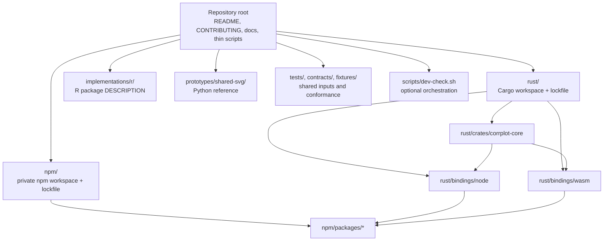

# Development setup by ecosystem

## Purpose

corrplot-ng is a multi-ecosystem repository. Each project owns its dependencies,
manifest, build, and tests. Install only the toolchain for the project you are
changing; a contributor does not need every ecosystem installed.

The current project roots are:

| Ecosystem | Current project root | Dependency manifest | Status |
| --- | --- | --- | --- |
| Rust | `rust/` | `rust/Cargo.toml`, `rust/Cargo.lock` | Shared core, CLI, Node and WASM binding crates |
| npm | `npm/` | `npm/package.json`, `npm/package-lock.json` | Private workspace; publication is deferred |
| R | `implementations/r/` | `implementations/r/DESCRIPTION` | Provisional production-facing R package; relocation is tracked by #368 |
| Python | `prototypes/shared-svg/` and repository-level contract tests | `requirements-dev.txt` | Reference/prototype only; relocation is tracked by #369 |

The Python requirements file is at the repository root because the same
`jsonschema` dependency is used by repository-level fixture and contract
checks. The Python reference itself is not an installable package and has no
`pyproject.toml`. The Rust/rextendr proof under `rust/bindings/r/` is a
separate disposable adapter, not the production R package.

## Project boundaries



The Rust core is the shared semantic implementation. npm bindings call it
through the Node-API and WASM crates. The Python code is a reference, not a
second authoritative core. R keeps its own legacy API and graphics-device
behavior. See [the architecture](architecture.md) and
[repository ownership](repository-layout.md).

## Common requirements

- Git.
- A shell appropriate to the commands below. Direct ecosystem commands can be
  run from their documented directories. The optional root orchestration
  script requires Bash (Linux, macOS, WSL, or Git Bash).
- A supported toolchain only for the ecosystem being changed.

Do not run npm or Cargo installation from the repository root. Do not create a
root-level Python virtual environment or install R libraries into the
repository. Generated dependency directories and build outputs are ignored and
must not be committed.

## Python reference and contract tests

**Use this section for:** the Python scene/SVG reference, shared fixture tests,
and schema validation. It does not create a distributable Python package.

Requirements: Python 3.10+ and pip.

Create the virtual environment inside the reference project, not at the
repository root:

```sh
python3 -m venv prototypes/shared-svg/.venv
```

Activate it:

```sh
# Linux / macOS / WSL / Git Bash
source prototypes/shared-svg/.venv/bin/activate

# Windows PowerShell
prototypes/shared-svg/.venv/Scripts/Activate.ps1
```

Install the shared Python test dependency from the repository root:

```sh
python -m pip install -r requirements-dev.txt
```

Run the relevant tests from the repository root:

```sh
python -m unittest discover -s tests -v
python -m unittest discover -s prototypes/normalized-matrix-v1 -p 'test_*.py' -v
python -m unittest discover -s prototypes/shared-svg -p 'test_*.py' -v
python -m unittest discover -s prototypes/publication-config-v1 -p 'test_*.py' -v
python -m unittest discover -s prototypes/publication-svg-v1 -p 'test_*.py' -v
```

Render and validate a reference SVG:

```sh
python prototypes/shared-svg/renderer.py prototypes/shared-svg/example.json > /tmp/corrplot-ng.svg
python scripts/validate_svg.py /tmp/corrplot-ng.svg
```

**Check/lint:** there is no separate Python linter or formatter configured.
The unit tests, fixture-integrity checks, schema validation, and SVG validator
are the current quality checks. There is no Python wheel or source
distribution to build. The generated SVG in the example command is a test
artifact, not a package artifact. Do not add a production Python package or
publish one without a separate maintainer decision. The future package
boundary is tracked by #369.

## R package

**Use this section for:** the provisional R package in `implementations/r/`.

Requirements: R 4.x, `corrplot` 0.95, `testthat`, `jsonlite`, and `png`.

Install the R packages from CRAN:

```sh
Rscript -e 'install.packages(c("corrplot", "testthat", "jsonlite", "png"), repos = "https://cloud.r-project.org")'
```

Run the package check from the repository root:

```sh
R CMD check implementations/r
```

`R CMD check` is the R package check/lint gate; no separate R linter is
configured. It checks package metadata, installation, documentation, and
tests.

Install the package locally:

```sh
R CMD INSTALL implementations/r
```

Build a source tarball outside the checkout.

Linux, macOS, WSL, or Git Bash:

```sh
REPO="$(git rev-parse --show-toplevel)"
(cd "${TMPDIR:-/tmp}" && R CMD build "$REPO/implementations/r")
```

Windows PowerShell:

```powershell
$repo = (git rev-parse --show-toplevel).Trim()
Push-Location $env:TEMP
R CMD build "$repo/implementations/r"
Pop-Location
```

The default `corrplot_ng()` path delegates to upstream corrplot. The
experimental scene path prepares scene-v1 data; it is not a complete renderer.
The production package does not yet use the Rust/rextendr adapter. Do not
change that release boundary as part of a documentation or layout task.

For the R scene consumer, run:

```sh
Rscript prototypes/shared-svg/test_r_scene_consumer.R
```

For the pinned legacy semantic oracle, use the root command
`bash scripts/dev-check.sh test-r-legacy` (requires both R and Python).

The production R package is expected to move to `r/corrplotng/` under #368.
Until that migration is merged, `implementations/r/` is the authoritative
package root.

## Rust workspace and CLI

**Use this section for:** the shared core, standalone CLI, and Rust binding
crates.

Requirements: Rust 1.78+; stable is used for ordinary development. The
committed lockfile is authoritative. Run Cargo commands from the repository
root with explicit manifest paths or with `rust/` as the working directory.

Run the shared core and CLI tests:

```sh
cargo test --locked --offline --manifest-path rust/crates/corrplot-core/Cargo.toml
cargo test --locked --offline --manifest-path rust/tools/corrplot-cli/Cargo.toml
```

Build the CLI:

```sh
cargo build --locked --offline --profile release-cli --manifest-path rust/tools/corrplot-cli/Cargo.toml
```

The executable is written to:

- Linux/macOS: `rust/target/release-cli/corrplot-ng`
- Windows: `rust/target/release-cli/corrplot-ng.exe`

The current Rust quality gate is the locked core/CLI test and build commands
above. There is no separate Clippy or rustfmt CI gate configured at present.
The release workflow creates platform archives; a local release-profile build
creates only the executable.

Check the portable core for WebAssembly when changing shared semantics:

```sh
rustup target add wasm32-unknown-unknown
cargo check --locked --offline --all-targets --target wasm32-unknown-unknown --manifest-path rust/crates/corrplot-core/Cargo.toml
```

The CLI README documents the executable, supported platforms, release
archives, and installation behavior. Native Node and browser-WASM binding
builds are described in the npm section because their package orchestration
and tests are owned by the npm workspace.

## npm workspace and JavaScript packages

**Use this section for:** native Node, browser WASM, TypeScript, React, and
Vue packages.

Requirements: Node.js 22, 24, or 26; npm 10 or later; Rust 1.78+ for native
builds; and `wasm-pack` 0.13.1 for WASM tests/builds. Install Rust with
rustup. Install the pinned WASM tool when needed:

```sh
cargo install wasm-pack --version 0.13.1 --locked
rustup target add wasm32-unknown-unknown
```

Install from the npm workspace root:

```sh
cd npm
npm ci --ignore-scripts
npm ls --workspaces --depth=0
```

Normal workspace installs retain optional platform dependencies. Do not use
`--omit=optional` for ordinary workspace development; that flag is reserved
for the isolated consumer smoke test.

Run the workspace package tests:

```sh
npm test
```

The TypeScript, React, and Vue test scripts also run TypeScript declaration
checks. To run those checks without the package runtime tests, use:

```sh
npm run test:types --workspace=@corrplot-ng/typescript
npm run test:types --workspace=@corrplot-ng/react
npm run test:types --workspace=@corrplot-ng/vue
```

There is no separate ESLint or Prettier configuration in the current npm
workspace; package tests and TypeScript checks are its configured quality
gates.

The workspace test command runs native Node, TypeScript, React, and Vue tests.
Run one package independently when possible:

```sh
npm run test:node
npm run test:typescript
npm run test:react
npm run test:vue
```

The WASM package has additional Rust/WASM tests and a generated browser
package. From `npm/packages/wasm/`:

```sh
wasm-pack test --node ../../../rust/bindings/wasm
npm run build
npm run test:pack
```

Build the native addon directly from `npm/packages/native-node/` with
`npm run build`. It requires the Rust toolchain.

After running the native Node tests and building the WASM package above,
validate all workspace package contents from `npm/`:

```sh
npm run pack:dry-run
```

This is a package-content dry run, not publication. The workspace is private.
The manual `Stage npm package tarballs (no publishing)` workflow creates the
coordinated package artifacts. Public npm publication remains deferred under
#293; do not run `npm publish` or configure registry credentials.

## Optional repository-wide orchestration

The root script delegates to the owning ecosystem commands. It is a
convenience, not a package manager or dependency root.

Run it from the repository root:

```sh
bash scripts/dev-check.sh quick
bash scripts/dev-check.sh test-r
bash scripts/dev-check.sh test-r-legacy
bash scripts/dev-check.sh test-rust-cli
bash scripts/dev-check.sh test-node
bash scripts/dev-check.sh test-wasm
bash scripts/dev-check.sh test-all
bash scripts/dev-check.sh build-cli
bash scripts/dev-check.sh build-node
```

| Command | Required toolchains |
| --- | --- |
| `quick` | Python |
| `test-r` | R |
| `test-r-legacy` | R and Python |
| `test-rust-cli` | Rust and Python |
| `test-node` | Node/npm and Rust |
| `test-wasm` | Node/npm, Rust, and wasm-pack |
| `test-all` | Python, R, Rust, Node/npm, and wasm-pack |
| `build-cli` | Rust |
| `build-node` | Node/npm and Rust |
| `benchmarks`, `benchmarks-stress` | Python |

`test-all` is the full local suite and therefore requires every listed
toolchain. It is not required for a change isolated to one ecosystem when
that ecosystem's targeted checks are sufficient.

Performance measurements are opt-in and write results to the system temporary
directory. Stress workloads are excluded from `quick` and `test-all`; run
`benchmarks-stress` only when explicitly measuring the larger stress cases.
Set `PYTHON=/path/to/python` to select a non-default Python executable.

The script is Bash-only. On Windows, use WSL or Git Bash. CI remains the
authoritative source for the full operating-system/runtime matrix.

## CI and release evidence

Pull requests run path-filtered checks for changed components. Comprehensive
OS/runtime matrices, package staging, and performance measurements may be
manual or scheduled. Read [CI validation tiers](ci-validation-tiers.md) before
treating a skipped job as a failure or assuming that a PR ran the full matrix.

The current architecture diagram is in [architecture.md](architecture.md).
This guide records how to work in each project root; it does not change
package support, production-R rollout, or publication decisions.
