# Catalog of diagrams and visualizations for corrplot-ng

## Purpose

This catalog lists the visual forms that corrplot-ng may support. It separates compatibility targets from ideas for later work.

This is a planning document. A listed item is not proof that the feature exists.

## 1. Existing correlation-matrix methods

The first goal is to cover the methods in the original R corrplot package.

The thumbnails below are small, schematic examples. They explain the visual form only. They do not define exact colors, scales, defaults, or output from the future implementation.

| Method | Example | Description | Plan |
|---|---|---|---|
| Circle | 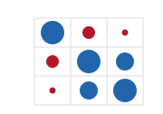 | Show each correlation as a circle. Use size and color to show its value. | Compatibility target |
| Square | 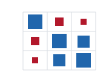 | Show each correlation as a square. Use size and color to show its value. | Compatibility target |
| Ellipse | 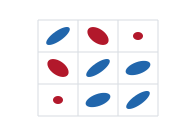 | Show each correlation as an ellipse. Use shape and color to show its value. | Compatibility target |
| Number | 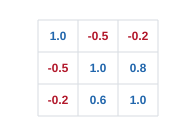 | Show each correlation as a number. | Compatibility target |
| Shade | 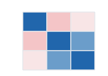 | Use shaded cells to show correlations. | Compatibility target |
| Color |  | Use colored cells to show correlations. | Compatibility target |
| Pie | 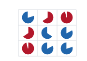 | Show each correlation as a pie-like shape. | Compatibility target |

## 2. Matrix layouts

These are layout options. They are not separate plot types.

- **Full matrix:** show both triangles of the matrix.
- **Upper triangle:** show only the upper triangle.
- **Lower triangle:** show only the lower triangle.
- **Mixed triangles:** use different methods or settings in the upper and lower triangles.
- **Diagonal control:** show, hide, or change the diagonal cells.
- **Variable order:** use the input order or a supported ordering method.
- **Variable groups:** show groups of related variables when the data and method support them.

## 3. Labels and annotations

The project should assess these shared options:

- Variable names and axis labels.
- Correlation values.
- Significance markers.
- Confidence intervals, where the input method provides them.
- Legends and color scales.
- Text size and label rotation.
- Missing-value display.
- Notes for selected cells.

The exact behavior and defaults must be defined in the API design.

## 4. Basic plots that support correlation analysis

The product should consider these common statistical plots. They are not all part of the original R corrplot API. Their role and priority must be agreed before implementation.

| Plot type | Example | Main use | Plan |
|---|---|---|---|
| Scatterplot | 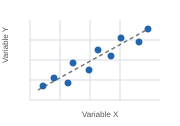 | Inspect the relationship between two variables and spot outliers or non-linear patterns. | Recommended basic plot |
| Scatterplot matrix (pairs plot) | 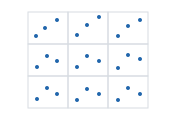 | Inspect pairwise relationships across several variables. | Recommended basic plot |
| Correlation heatmap |  | Compare many correlation values in a compact matrix. | Compatibility target |
| Numeric correlation matrix |  | Read exact correlation values. | Compatibility target |
| Correlation matrix with significance marks | Use a matrix method with significance markers. | Separate effect size from evidence about statistical significance. | Recommended shared option |
| Correlation matrix with confidence intervals | Use a matrix method with interval values or interval annotations. | Show uncertainty when estimates and suitable intervals are available. | Recommended shared option |

A scatterplot and a scatterplot matrix are useful companions to a correlation matrix. They help users check whether a correlation is driven by outliers, subgroups, or a non-linear relationship. These plots need their own data and API design; they should not be treated as just another cell-rendering method.

## 5. Recommended additional visualizations

These are candidates for later releases. They need design, user feedback, and a clear use case before implementation.

| Visualization | Example | Main use | Priority |
|---|---|---|---|
| Clustered correlation heatmap | 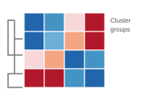 | Group similar variables and reveal blocks of related variables. | High candidate |
| Correlation network | 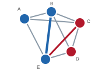 | Show selected strong relationships as links between variables. | High candidate |
| Partial-correlation network | 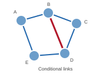 | Show conditional relationships after accounting for other variables, when valid estimates are available. | Candidate |
| Pairwise correlation panel |  | Compare several pairwise relationships in one view. | Candidate; overlaps with scatterplot matrix |
| Multi-matrix comparison | 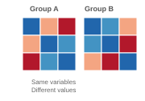 | Compare correlation matrices across datasets, groups, or time periods. | High candidate |
| Correlation change plot | 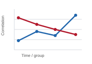 | Show how correlations change across groups or time. | High candidate |
| Interactive correlation matrix | A web view with cell inspection and variable selection. | Inspect values and explore large matrices. | Candidate |
| Correlation difference matrix | A diverging-color matrix of differences between two correlation matrices. | Locate relationships that changed between groups or time periods. | Candidate |
| Robust correlation view | A matrix or pairwise plot using a robust correlation estimator. | Reduce sensitivity to outliers when the selected estimator supports this. | Candidate |
| Rank-correlation view | A matrix using Spearman or Kendall correlation. | Show monotonic relationships when Pearson correlation is not suitable. | Candidate |
| Lagged cross-correlation plot | A plot of correlation values across time lags. | Explore time-series relationships with appropriate statistical care. | Candidate |
| Correlation uncertainty view | A matrix that encodes standard errors, intervals, or bootstrap uncertainty. | Show how uncertain correlation estimates are. | Candidate |

The labels “High candidate” and “Candidate” are proposals, not a committed roadmap. Priorities should be reviewed against user needs, technical cost, and the limited time available for development.

## 6. Scope boundaries

The project should keep the first release focused.

- **Core scope:** the seven original corrplot methods, matrix layouts, labels, scales, annotations, and legacy R compatibility.
- **Strong next candidates:** clustered heatmaps, network views, and comparisons between correlation matrices.
- **Supporting statistical plots:** scatterplots and scatterplot matrices, if they can be added without delaying core compatibility.
- **Research features:** partial correlations, robust estimates, rank correlations, lagged cross-correlations, and uncertainty views require careful statistical definitions and documentation.
- **Interactive views:** consider them after the shared plot model and static output are stable.

## 7. Shared visual rules

Where possible, plot types should use the same rules for:

- Mapping values to colors.
- Mapping values to size or shape.
- Handling missing values.
- Showing positive and negative values.
- Showing legends and scales.
- Selecting and ordering variables.
- Showing annotations.
- Exporting or rendering output.

A shared rule should have one definition in the core. Language interfaces should not change its meaning without a clear reason.

## 8. How to add an item

For each new item, record:

1. The user problem it solves.
2. The data it needs.
3. The visual form and its meaning.
4. The options and defaults.
5. How it handles missing or invalid data.
6. Whether it must match an existing R feature.
7. How to test it.
8. Which language interfaces should support it.

## 9. Next steps

- Check the compatibility list against the current R package documentation.
- Add examples for each existing method.
- Mark the features that users need most.
- Test the proposed shared visual rules with a small prototype.
